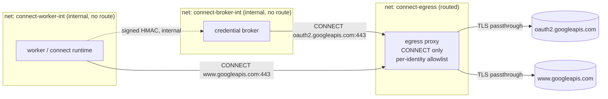

# Connect egress: how the broker and worker reach Google, and nothing else

Status: **topology proven in an isolated staging smoke test on 2026-11-14 (14/14).** The production proxy component is not yet chosen or deployed.

## 1. Who talks to which host

| Identity | Needs | Allowed destination | Never |
|---|---|---|---|
| credential broker | token refresh, token revoke | `oauth2.googleapis.com:443` | Calendar or any data API; anything else |
| worker (Connect runtime) | Calendar API call with a short-lived access token | `www.googleapis.com:443` | token endpoint; anything else |
| web (**current implementation**) | OAuth code exchange in the callback; the resulting token set is handed to the broker's `store_oauth_result` | `oauth2.googleapis.com:443` (its own listener) | data APIs; anything else |

**Known gap, tracked:** today the web callback exchanges the code (as the existing `@tugpt/appointments` flow does), so the web holds the Google client secret and briefly sees the token set. The recommended follow-up is a broker operation `exchange_oauth_code`: the web sends `code` plus the PKCE verifier over the signed channel, and the broker exchanges and stores. After that, the web needs **no** Google egress, the client secret exists only on the broker host, and tokens never pass through the web process. It should land before staging holds a real token, and it doesn't change the egress design apart from removing the web listener.

Splitting by identity limits each component to its own job. A compromised worker can't mint tokens, because it can't reach the token endpoint and holds no refresh token. A compromised broker can't read calendars, because it can't reach the data API.

Each new provider adds its own host pair. Microsoft would add `login.microsoftonline.com` for the broker and `graph.microsoft.com` for the worker, through a reviewed change to the proxy policy.

## 2. Topology

- Broker and worker sit on Docker networks created with `--internal` (no default route), so a library or a compromised dependency cannot bypass the proxy.
- The proxy is attached to each internal network and to one routed network. **It identifies callers by network/listener, not by headers.**
- **TLS is end to end.** The proxy sees only `host:port`, never tokens, and does no TLS interception. The client verifies the Google certificate itself.
- The admin MCP bridge is on none of these networks. Its host address is refused by the proxy, as tested below.

## 3. Proxy policy (enforced before any upstream socket is opened)

1. `CONNECT` only; anything else returns 405.
2. `host:port` must match the listener's allowlist **exactly**, case-folded. No wildcards, no suffix matching (`oauth2.googleapis.com.evil.example` is refused).
3. Resolve once. Every address must be public unicast: no RFC1918, loopback, link-local or metadata (`169.254.169.254`), CGNAT, ULA, multicast or reserved ranges. Then connect to **the address that was checked**, so there is no DNS-rebinding window.
4. One JSON log line per decision (identity, client address, target, allow/deny, reason). No headers, no payload.
5. Connect timeout 10 s, idle timeout 60 s, and a per-identity connection cap.

## 4. Client side

Node 22's built-in `fetch` ignores `HTTPS_PROXY`. Two options:
- (a) a proxy-aware dispatcher (`undici` `ProxyAgent`) passed explicitly to the broker's refresher and the calendar tool's `fetch`
- (b) a minimal CONNECT + TLS helper like the smoke probe

**Recommendation: (a).** `undici` is maintained by the Node.js project. It becomes an allowlisted dependency of the broker and of the worker package that builds the tool `fetch`, but **not** of `connect-runtime`, where the tool receives `fetch` by injection. The proxy URL is configuration (`CONNECT_EGRESS_PROXY=http://egress-proxy:3128`), not a secret. Fail closed: if the variable is unset in staging or production, the broker refuses to start, rather than attempting direct egress (which the network would block anyway).

## 5. Production component

The smoke harness is a 150-line Node script, written only to prove the topology. Production should run a maintained proxy configured with the same policy.

| Option | Fit | Notes |
|---|---|---|
| **Smokescreen** (Stripe, Go) | purpose-built CONNECT egress allowlist with private-range blocking | **recommended**; small; no TLS interception |
| Squid | mature, `CONNECT` plus `dstdomain` ACLs | more configuration surface; needs explicit private-range ACLs |
| Envoy | powerful | heavier than needed here |

All three are free and self-hosted, and run in a container on the same host. No paid service is required.

## 6. Evidence (staging smoke, 2026-11-14)

**Setup:**
- Two Docker networks on the dev VPS: `--internal` plus routed.
- Proxy container: read-only, `--cap-drop ALL`, `no-new-privileges`, non-root user, **no published ports**.
- Probe container: internal network only.
- No credentials were used. The Google requests were unauthenticated public endpoints.

**Results, 14/14 pass:**

| Check | Result |
|---|---|
| direct TCP to a Google IP | `ENETUNREACH` (no route) |
| direct TCP by hostname | `EAI_AGAIN` (no external DNS) |
| broker → `oauth2.googleapis.com:443` via proxy | 200 CONNECT; TLS `authorized=true`; Google answered HTTP 404 on `/` |
| worker → `www.googleapis.com:443` via proxy | 200 CONNECT; TLS `authorized=true`; Calendar discovery document HTTP 200 |
| broker → `www.googleapis.com` | 403 |
| worker → `oauth2.googleapis.com` | 403 |
| `example.com:443` | 403 |
| `oauth2.googleapis.com:80` | 403 |
| `oauth2.googleapis.com.evil.example:443` | 403 |
| `169.254.169.254:80` | 403 |
| `127.0.0.1:8080` | 403 |
| `82.165.50.109:443` (this host, where the admin bridge runs) | 403 |
| `10.0.0.1:443` | 403 |
| plain-HTTP forward request | 405 |

Evidence files are under `/srv/tugpt-workspace/tugpt-connect-evidence/` on the dev VPS:
- `egress-smoke-probe.json`
- `egress-smoke-proxy.log`
- `egress-smoke-harness/{proxy.cjs,probe.cjs}`

All containers and networks were removed afterwards.

**Not proven yet:** the non-public-address check after DNS (rule 3) was not triggered in this run, because every hostile target was already refused by the allowlist. It will be covered by unit tests of the production proxy configuration: Smokescreen ships its own tests for this, and we add a resolver-override case.
