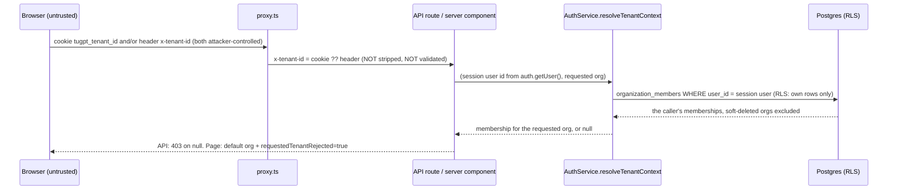

# Evidence: active-organization selection cannot reach another organization

Question from the owner (2026-11-14): *can the active-organization selection be manipulated to access another organization's connections or tools?*

**Answer: no, on every path that exists today.** The selection is only ever a *request*. Authorization is checked separately at four layers, and each layer has tests, including tests that fail when the check is removed.

## 1. How the selection travels

Facts verified in code (2026-11-14):
- `proxy.ts` forwards `cookie ?? header`. **A client-supplied `x-tenant-id` is passed through when there is no cookie, and is never stripped.** That is acceptable only because nothing downstream treats it as authorization. A new test pins the cookie-wins precedence.
- `AuthService.resolveTenantContext(userId, requested)` returns the matching membership or **null**. It never falls back when an organization was requested. The user id always comes from `supabase.auth.getUser()`, never from the request.
- `resolveSessionTenant` (server components only) *does* fall back to the default org when the selection is rejected, because pages have to render something. It reports `requestedTenantRejected`, and it doesn't authorize anything: every mutation goes through an API route that answers 403.
- The Google start and disconnect routes also accept a `?tenant=` hint. That is the same kind of request, and it gets the same 403.

## 2. Layered evidence

| Layer | What is proven | Tests | Location |
|---|---|---|---|
| **API routes** | A forged `x-tenant-id` **or** `?tenant=` for a non-member org gives 403 with no side effect (no OAuth state minted, nothing revoked). No silent fallback to the default org. Membership is looked up for the session user only. Role is per org (agent in org X can't connect in X). A stale or removed membership is refused, not re-pointed. | **10 new**, run against the **real** `AuthService` with a fake Supabase that returns only the caller's rows | `apps/web/src/app/api/v1/integrations/google/google-oauth-org-isolation.test.ts` |
| API routes (existing) | Tenant and 403 cases across conversations, drafts, invitations, media jobs, knowledge, analytics, assignment and the general route suite | tenant cases in 9 route test files | `apps/web/src/app/api/v1/**/*.test.ts` |
| **AuthService** | requested org not among memberships gives null; soft-deleted org filtered; no membership gives null | 5 | `packages/auth/src/service.test.ts` |
| **Proxy** | cookie beats a conflicting client header; header only forwarded as a request | **1 new** + 2 existing | `apps/web/src/proxy.test.ts` |
| **Page resolver** | rejected selection falls back to default and is flagged; malformed values never reach the DB | 18 | `apps/web/src/lib/tenant/{resolve,server}.test.ts` |
| **Database (RLS + FKs)** | owner of B sees only B's connection; B can't revoke A's connection (`CONNECT_NOT_FOUND`, no existence oracle); ciphertext, grants, MCP snapshots and endpoint auth can't be attached across orgs (composite FKs); `authenticated` can't read ciphertext | 37 in the connect file (part of 1,193) | `supabase/tests/database/connect_registry.test.sql` |
| **Tool runtime** | a cross-org connection id gives `CONNECTION_NOT_FOUND` before any token request or Google call, **even if the directory ignores the org filter** (defence in depth: the runtime re-checks `record.organizationId`) | 10-case deny table | `packages/connect-runtime/src/runtime.test.ts` |
| **Credential broker** | right connection id under the wrong org gives 404 (no existence oracle); ciphertext transplanted between connections fails to decrypt (AAD) | 2 + isolated container smoke (404 cross-org) | `packages/credential-broker/src/{service,server}.test.ts`, `broker-smoke-probe.json` |

## 3. Mutation checks (2026-11-14)

Each check was planted in the code, the relevant tests were run, and the code was then restored.

| Mutation | Result |
|---|---|
| start route falls back to the default org when the requested org is rejected | **4 tests fail** |
| disconnect route falls back likewise | **2 tests fail** |
| proxy lets the client header override the cookie | **1 test fails** |

Earlier (Phase 0): removing the runtime's org re-check was caught by the deny table.

## 4. Residual risks and follow-ups

1. **Proxy forwards client headers.** Safe today, because every consumer re-validates membership. Hardening (recommended, small): the proxy deletes any inbound `x-tenant-id` and re-derives it only from the cookie, so the header path disappears. This removes one class of mistake in future routes. Not done in this PR, because existing API clients may send the header; this needs a check of callers first.
2. **`?tenant=` on GET `/integrations/google/start`.** It is a top-level navigation, so a cross-site link could start consent for one of the victim's own admin orgs. Impact is low: Google shows its consent screen, and the result binds only to an org the victim administers. Follow-up: drop the query hint once the switcher cookie is universal.
3. **Database-backed Connect lookups** are not built yet. Their cross-org integration tests are specified in `docs/connect/db-backed-lookups.md` and must pass before staging.
4. **Worker jobs:** the org of a tool call comes from the job row written by an authenticated route, never from model output. To be enforced and tested when chat is wired to the runtime (ADR-020 M2).
