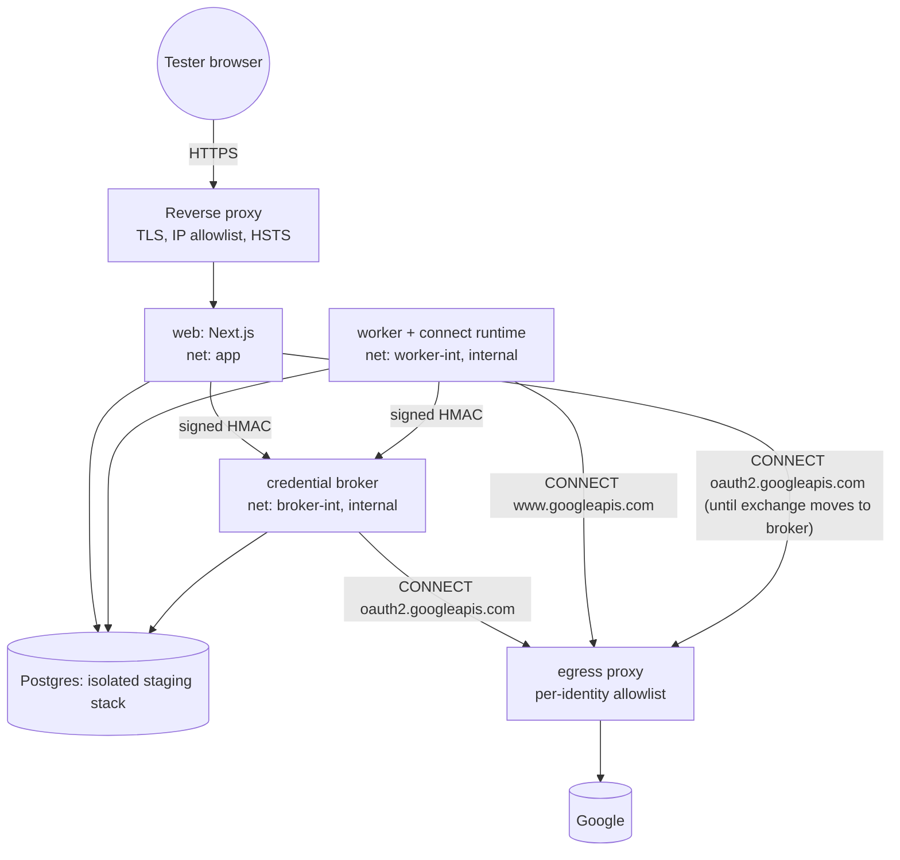

# Staging setup requirements (preparation only, nothing created)

Owner decisions of 2026-11-14:
- **Langdock:** test not yet authorized.
- **Google staging OAuth:** preparation only.
- **Staging domain:** preparation only.

This document lists exactly what has to exist and who creates it. **No vendor application, OAuth client, DNS record or paid service has been created.** The canonical domain is `tugpt.pro`; `tugpt.app` is never used (it does not resolve, verified 2026-11-14).

---

## A. Staging domain `staging.dashboard.tugpt.pro`

### A1. DNS (owner action at the `tugpt.pro` DNS provider)

| Record | Value | TTL | Notes |
|---|---|---|---|
| `staging.dashboard.tugpt.pro. A` | IP of the staging host (see A4) | 300 | Raise to 3600 once stable. No AAAA, matching production. |
| `tugpt.pro. CAA` *(optional, recommended)* | `0 issue "letsencrypt.org"` | 3600 | No CAA record exists today. This restricts issuance for **all** subdomains, including production, so it is a production-affecting change and needs separate approval. |

Checked 2026-11-14: `staging.dashboard.tugpt.pro` currently has no A or AAAA record, and `dashboard.tugpt.pro` resolves to `212.227.44.13`.

### A2. TLS

- Let's Encrypt certificate for `staging.dashboard.tugpt.pro` only, issued with HTTP-01 by the staging reverse proxy (Caddy or nginx with certbot), auto-renewed. Free.
- **HSTS consequence:** production sends `Strict-Transport-Security: max-age=31536000; includeSubDomains` on `dashboard.tugpt.pro`. Any browser that has visited production will force HTTPS on `staging.dashboard.tugpt.pro`, so staging must serve valid TLS from its first request. There is no "HTTP for a day" phase.
- Staging response headers: the same security headers as production, plus `X-Robots-Tag: noindex, nofollow`.

### A3. Access restriction

Staging is not public. Pick one:
- a reverse-proxy IP allowlist (simplest)
- SSO-only login, with sign-up disabled

Google OAuth callbacks still work behind either, because the browser making the callback is the tester's own.

### A4. Host and architecture

| Option | Cost | Assessment |
|---|---|---|
| **(1) Dev VPS `82.165.50.109`, isolated Docker networks** | none | Acceptable **only** with test accounts and synthetic data. The admin MCP bridge runs on this host, which is why the egress proxy refuses this host's address (tested). |
| (2) Separate small VPS | paid; needs approval | Required before any real customer data or a customer pilot. |

Recommendation: (1) for Phase 0 and 1 validation; (2) before a pilot.



- **Database:** a self-hosted, isolated Supabase stack dedicated to staging, the same way as the `tugpt-connect-p0` test stack. It is disposable and costs nothing. Applying the Connect migration to the shared non-production project `andyyuwynkwivuwuhxab` instead needs a separate per-change approval.
- **Secrets** (names only; values are created on the host by the owner, never pasted in chat):
  - `tugpt_keyring` (broker)
  - `broker_caller_key_web`, `broker_caller_key_worker`
  - `connect_broker_db_password`
  - `google_oauth_client_secret_staging`
  - `supabase_service_key_staging`
  - `langdock_probe_key` (only for the probe; see C)

  All are Docker secrets or `systemd-creds`, mode 0400, and readable only by the consuming container.
- **Non-secret configuration:**
  - `GOOGLE_OAUTH_REDIRECT_URI=https://staging.dashboard.tugpt.pro/api/v1/integrations/google/callback`. Required: without it the callback uses the container address. That is the production defect found on 2026-11-14; see the production verification record.
  - `CONNECT_EGRESS_PROXY=http://egress-proxy:3128`
  - `CONNECT_BROKER_URL=http://credential-broker:8080`

### A5. Callback URLs (staging)

| Flow | URL |
|---|---|
| Connect (new, ADR-021) | `https://staging.dashboard.tugpt.pro/api/v1/connect/oauth/callback/google` |
| Existing Google Calendar flow (must stay registered) | `https://staging.dashboard.tugpt.pro/api/v1/integrations/google/callback` |
| Supabase auth (SSO login) | `https://staging.dashboard.tugpt.pro/auth/callback` |

---

## B. Google staging OAuth (owner creates; I don't)

**Do not touch the production Google project or credential.** Everything below lives in a **new, separate** Google Cloud project.

| Item | Exact value |
|---|---|
| Project | new project, e.g. `tugpt-staging`, under the owner's Google Cloud organization or account. Billing **not** required: Calendar API and OAuth are free. |
| APIs enabled | **Google Calendar API** only |
| OAuth consent screen: user type | **External** |
| Publishing status | **Testing** (no Google verification needed; at most 100 test users) |
| App name | `TuGPT (Staging)` |
| User support / developer contact email | an owner-controlled `@tugpt.pro` address |
| App home page / privacy / terms | `https://tugpt.pro`, `https://tugpt.pro/privacy`, `https://tugpt.pro/terms`. Not required while in Testing, but required later for verification. |
| Authorized domains | `tugpt.pro` |
| Scopes | `https://www.googleapis.com/auth/calendar.freebusy` (the existing flow requests exactly this and refuses a grant without it). Do **not** add `calendar.readonly` or any write scope. `openid` and `email` are optional; they would only populate the vendor account id and display name, and are not needed for the first test. |
| OAuth client type | **Web application**, name `tugpt-connect-staging` |
| Authorized JavaScript origins | none (server-side flow) |
| Authorized redirect URIs | exactly the two Google URLs in A5. No localhost, no wildcards; local development uses its own separate client. |
| Request parameters (already in code) | `access_type=offline`, `prompt=consent`, `response_type=code`, signed `state`. PKCE S256 is planned for the Connect flow. |

**Test accounts:**
- **Account 1:** a dedicated Google account for staging only, e.g. a `@tugpt.pro` Workspace user. It holds no customer data, has 2-step verification on, is owned by the owner, and is listed as a test user on the consent screen. Seed its calendar with synthetic events.
- **Account 2 (optional):** a second test user, to verify that a personal connection of user A can't be used by user B, and that org B can't see org A's connection, end to end.
- **Testing-mode limitation:** Google expires refresh tokens issued to apps in Testing status after **7 days**. That is useful for exercising the `requires_authorization` → reconnect path. A staging connection meant to last longer needs the app moved to "In production", which needs Google verification for the sensitive Calendar scope (free, but takes time).

**Delivering the client secret** (never through chat):
1. The owner creates the client in the Google console and downloads the JSON.
2. The owner places it on the staging host from their own terminal, writing to the secret store with mode 0400:
```bash
sudo install -d -m 700 /etc/tugpt/secrets
sudo sh -c 'umask 077; cat > /etc/tugpt/secrets/google_oauth_client_staging.json' < client_secret_XXXX.json
shred -u client_secret_XXXX.json
```
3. I reference only the file path. I never print, copy or move the contents.

**Acceptance for the live Calendar test:**
1. The test user connects in staging.
2. The connection row reaches `connected`.
3. `calendar.find_availability` returns free slots for a synthetic busy pattern.
4. The broker access log shows `get_access_token` ok.
5. The proxy log shows exactly one host per identity.
6. Revoke works.
7. After revoke the tool returns `REAUTHORIZATION_REQUIRED`.

---

## C. Langdock tool-calling probe (not authorized to run yet)

### C1. What will be tested

| Item | Value |
|---|---|
| Endpoint | `https://api.langdock.com/openai/eu/v1/chat/completions` (EU) |
| Models (`LANGDOCK_ALLOWED_MODELS`) | `gpt-5-mini`, `gpt-5`, `gpt-5.1`, `gpt-5.2` |
| Scenarios per model | 4: `multi_call`, `tool_selection`, `no_tool_needed`, `result_roundtrip` |
| Hard cap | **16 requests total**, `max_completion_tokens` 800, sequential, enforced in code (`PROBE_MAX_REQUESTS`) |
| Safeguards | refuses to run without `--confirm-nonprod`; reads the key from a file only (`LANGDOCK_PROBE_KEY_FILE`; refused unless group/other have no permissions, i.e. 600 or 400); never logs the key; non-sensitive synthetic prompts |

### C2. Estimated cost

Prices from migration `20260903000005_multi_currency_and_langdock_prices.sql`, the source checked by `langdock-price-coverage.test.ts`, in EUR per 1M tokens.

Worst case assumes each request uses **2,000 input tokens** (a deliberately generous upper bound for a short prompt plus one tool schema) and the full **800 output tokens**.

| Model | Input €/1M | Output €/1M | 4 requests, worst case |
|---|---|---|---|
| gpt-5-mini | 0.21 | 1.71 | €0.0072 |
| gpt-5 | 1.07 | 8.57 | €0.0360 |
| gpt-5.1 | 1.07 | 8.57 | €0.0360 |
| gpt-5.2 | 1.50 | 12.00 | €0.0504 |
| **Total (16 requests)** | | | **≈ €0.13 worst case**; realistically well under €0.05 |

Against the limits: 16 requests and at most ~45k tokens across four models, far inside 500 RPM / 150k TPM and the per-model quota noted in the repo.

### C3. Secure key provisioning (owner, from their own SSH session; never in chat)

1. In Langdock, create a **new, dedicated** API key named `tugpt-staging-toolcall-probe`. Don't reuse the production key. If the workspace offers a per-key spending or usage limit, set the lowest available value.
2. On the dev VPS, as root, write it to a file without echoing it to the screen or shell history:
```bash
install -d -m 700 /srv/tugpt-workspace/secrets
( umask 077; read -rs -p 'Langdock non-prod key: ' K; echo; printf '%s' "$K" > /srv/tugpt-workspace/secrets/langdock-probe.key; unset K )
stat -c '%a %U' /srv/tugpt-workspace/secrets/langdock-probe.key   # expect: 600 root
```
3. Tell me in chat only "**probe key is in place, run approved**". Then I run:
```bash
LANGDOCK_PROBE_KEY_FILE=/srv/tugpt-workspace/secrets/langdock-probe.key \
  node packages/ai-providers/dist/tool-calling-probe-cli.js --confirm-nonprod \
  --out /srv/tugpt-workspace/tugpt-connect-evidence/tool-calling-probe.json
```
4. Immediately afterwards: `shred -u /srv/tugpt-workspace/secrets/langdock-probe.key`. The owner **revokes the key** in Langdock. I report per-model pass/fail, token usage and actual cost from the response `usage` fields.

**Known risk, flagged earlier:** the existing chat adapter (`langdock.ts`) sends `temperature: 0.7` and `max_tokens`, which GPT-5-family models may reject. The probe uses `max_completion_tokens` and no `temperature`. If the probe passes but chat fails, that adapter is the reason. It is a separate fix.
