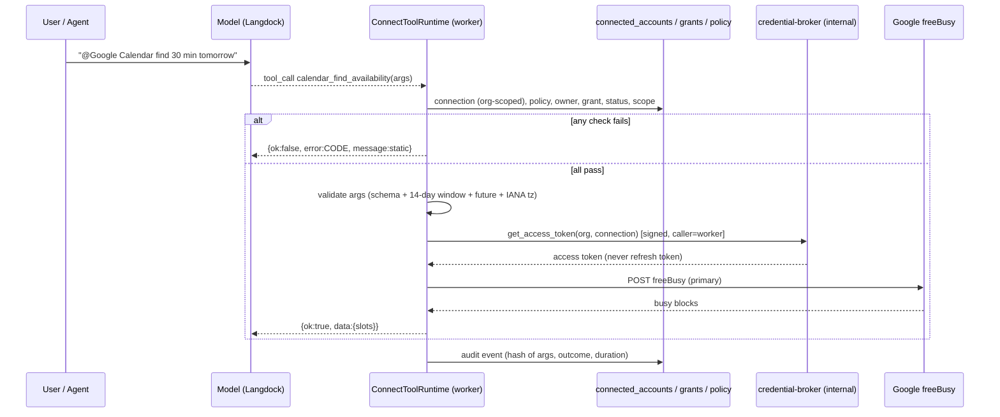

# Connect tool runtime and the Google Calendar read-only slice

Status: **implemented and tested offline (stubbed Google, real in-process credential broker). Not wired into web or worker. No live Google call has been made.**

## Components

| Piece | Location | Role |
|---|---|---|
| `ToolCallingModelAdapter` | `packages/ai-providers/src/tool-calling.ts` | Model proposes calls; output treated as untrusted (see `model-tool-calling.md`) |
| `ConnectToolRuntime` | `packages/connect-runtime/src/runtime.ts` | The only thing that turns a proposal into an external call |
| `calendar.find_availability` | `packages/connect-runtime/src/google-calendar-tool.ts` | Wraps the existing `GoogleFreeBusyProvider` (`@tugpt/appointments`) |
| `BrokerClient` | `packages/credential-broker/src/client.ts` | HMAC-signed calls to the internal broker; typed results, no throws |

## Check order (fail closed; no credential before authorization)

1. Registered tool → else `UNKNOWN_TOOL`. The admin MCP bridge is never registered (ADR-020 A1.3).
2. Connection found **within the caller's org** → else `CONNECTION_NOT_FOUND`. This is checked again on the returned row, so a directory that drops the org filter still cannot leak.
3. Provider matches the tool → else `PROVIDER_MISMATCH`.
4. Org policy enables the capability → else `POLICY_DISABLED`.
5. A personal connection may only be used by its owner → else `NOT_GRANTED`. Sharing is deferred.
6. An explicit grant exists for the actor or agent and the capability → else `NOT_GRANTED`.
7. Status is `connected` → else `REAUTHORIZATION_REQUIRED` or `CONNECTION_NOT_ACTIVE`.
8. The connection holds an accepted scope (`calendar.freebusy`, or the superset `calendar.readonly`) → else `SCOPE_MISSING`.
9. A write-risk tool → `APPROVAL_REQUIRED`. The approval flow is not in this slice.
10. Arguments are valid → else `INVALID_ARGUMENTS`.
11. The broker token is issued → else `REAUTHORIZATION_REQUIRED` or `PROVIDER_UNAVAILABLE`.
12. The output is at most 8 KiB → else `OUTPUT_TOO_LARGE`.

Multiple calls in one turn run **serially**, capped at 8 per turn (`CALL_BUDGET_EXCEEDED`). A refused call does not abort the others. Each call writes exactly one audit event. Messages returned to the model are static, so provider error text never reaches it.

## Test evidence

- `packages/connect-runtime`: 36 tests. These cover end-to-end via the real broker HTTP server, all 10 authorization refusals (each asserting zero token requests and zero Google calls), 9 argument-validation cases, a broker-side revoke, Google 401/500, serial execution (max in-flight = 1), the call budget, the approval gate, the output cap, handler exceptions, audit-sink failure, and the registry shape accepted by the model adapter.
- Mutation checks: each of the following made at least one test fail:
  - removing the org re-check
  - removing the owner check
  - removing the scope check
  - removing the risk gate
  - parallel execution
  - removing the grant check
  - fetching the token before authorization (21 failures)
- `packages/credential-broker`: `client.test.ts` adds 10 tests against the real server, for 56 in total.

## Not done / next

- **Wiring.** Postgres implementations of `ConnectionDirectory`, `IntegrationPolicy`, `GrantChecker` and `ToolAuditSink` over migration `20261112000001`. Also the worker composition root and the chat `@` picker.
- **Postgres `CredentialStore`** for the broker (currently `InMemoryCredentialStore`).
- **Live test.** Needs an owner-provisioned **staging** Google OAuth client and a dedicated test Google account. The production credential stays untouched (owner decision #4).
- **Seeded capability row.** `calendar.find_availability` is seeded with `is_available=false`. Flip it only after the live staging test.
