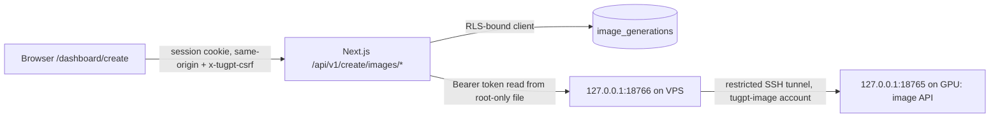

# Create › Images

Private text-to-image generation on TuGPT's own EU GPU (H200, `Tongyi-MAI/Z-Image-Turbo`,
pinned revision). Prompts and images never go to a third-party image service.

## Request path

* The GPU API listens on GPU loopback only. Nothing about it is public.
* The VPS reaches it through `tugpt-gpu-image-tunnel.service`, which uses its own key and its own
  GPU account. The key is pinned to the VPS source IP and may forward to `127.0.0.1:18765` only:
  no shell, no other ports (verified: shell refused; 11434 and 22 "administratively prohibited").
* The web server accepts only a loopback `http://` origin for `TUGPT_IMAGE_SERVICE_URL`. Anything else
  disables the feature instead of sending the token elsewhere.

## Authorization

| Layer | Rule |
|---|---|
| Proxy | `/api/v1/create/*` is `protected` (session required, 401 JSON). It is not under any of the prefixes the gateway holds for review. |
| Route | Tenant resolved strictly from the session; a stale or foreign tenant hint is 403. The request body cannot carry an organization (allow-listed fields: `prompt`, `size`, `seed`). |
| Mutation | Same origin, `x-tugpt-csrf: 1`, `application/json`. |
| DB | `image_generations` RLS (forced): owner only, and only while a member of the organization. Org owners/admins do **not** see colleagues' prompts. Prompt, size, seed, owner and organization are immutable. |
| GPU | Jobs are scoped by organization id. The web route reads the row through RLS **before** any status, result or cancel call, which adds the per-user boundary. |
| Output | Job payloads are validated. Results are size-capped (20 MB) and PNG magic-checked, then served with `nosniff`, `default-src 'none'; sandbox`, `private, no-store`. |

The pgTAP suite `supabase/tests/database/create_images.test.sql` covers 16 cases:
- cross-tenant reads and writes
- a same-org owner reading a member's rows
- immutability
- size checks
- a member who leaves the organization

## Limits (enforced by the GPU service)

* Sizes: 1024×1024, 1280×720, 720×1280. Prompt 1–1000 characters. Seed 0–2147483647.
* One active job per organization (`ORGANIZATION_BUSY`, 429), and at most 16 queued jobs across all tenants (`QUEUE_FULL`).
* 5 GB result storage cap (`STORAGE_LIMIT`, 507). Results whose file is gone are marked `expired`.

## Configuration

| Variable | Value (dev) | Secret? |
|---|---|---|
| `TUGPT_IMAGE_SERVICE_URL` | `http://127.0.0.1:18766` | no |
| `TUGPT_IMAGE_SERVICE_TOKEN_FILE` | `/etc/tugpt-gpu-image/api-token` (0600 root) | the file is; the path is not |

The token is read per request, so rotating it needs no restart. It is never logged or returned, and it never appears in error messages (asserted in `image-service.test.ts`).

## Known gaps

* **No usage metering or budget yet.** Generation is free and unmetered in dev. The GPU's one-job-per-org limit is the only throttle. Usage & costs must count images before this reaches customers.
* **No content-safety filter on prompts or outputs.** This is required before production.
* **No delete from history.** Results live on the GPU until the storage policy removes them.
* **Not in Chat yet.** Images are available on the Create page only.
* **English only.** The Create page is not localized yet, matching the page it replaced.
