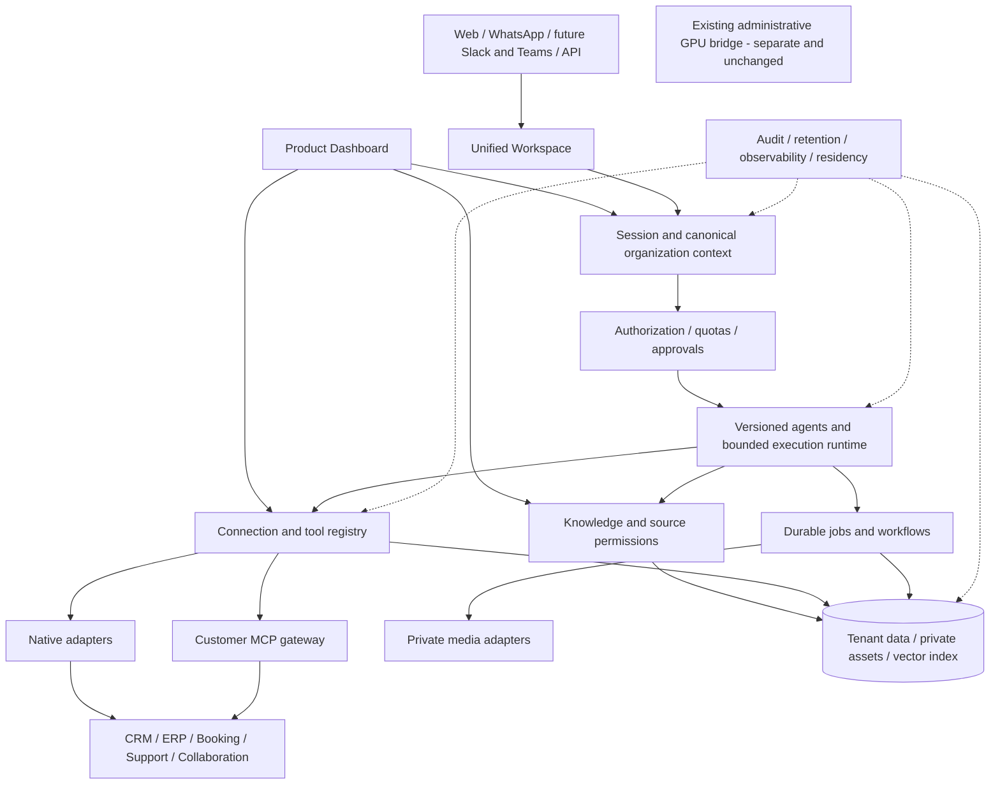

# TuGPT unified platform: architecture audit and delivery roadmap

**Status:** proposed architecture for review; documentation only, not a deployment announcement.

**Source baseline:** main `e82dcec5bf139cc0f0164f7877822719fcf4259f`, audited 1 November 2026. Additional validation is recorded below. Product requirements come from all three pages of the owner-supplied TuGPT Platform Blueprint.

## 1. Executive decision

Build **one unified TuGPT platform** on the existing monorepo, with two coherent authenticated experiences:

- **Product Dashboard:** products, agents, integrations/MCP, knowledge, workflows, CRM/messaging setup, people/teams, permissions, usage, quotas and billing.
- **Unified Workspace:** persistent agent conversations, research, files/documents, knowledge, authorized tools, media, history and reusable work.

Keep the public website at https://tugpt.pro intact. Reuse the current modular application and worker foundations rather than rewriting the system or introducing disconnected applications.

The repository has substantial messaging, identity, tenant authorization, secret-storage, job, knowledge and media-API foundations. It does **not** yet establish a deployed enterprise workspace, authorized `@` discovery, customer MCP runtime or general reusable-agent platform.

First prove: **sign in → organization → Workspace → agent conversation → `@` → actual authorized connection/tool → real execution → persisted result**. Existing Google Calendar free/busy code is the best initial read-only connector candidate. No usable customer connection was verified by this audit; staging configuration and real OAuth consent remain prerequisites. Never simulate successful execution.

After this narrow platform foundation, deliver the blueprint's six-item WhatsApp MVP: shared inbox, human takeover, approved knowledge, AI-assisted replies, lead capture and one CRM/booking integration.

## 2. Boundaries

- No change to the established MCP-to-GPU administrative bridge or its authentication.
- Administrative/root tools must never appear in customer discovery or execution.
- Preserve production services, public routing, secrets, assets, caches and infrastructure.
- No unapproved paid services, model downloads, licensing or security-boundary changes.
- Hyperframes/HeyGen remains abandoned; LTX-2.5 remains on licensing hold; cancelled GPU renaming remains cancelled.
- Media Studio belongs inside TuGPT. Preserve the owner's nearly black/charcoal design, gray borders/type and restrained cyan, without purple/orange gradients.
- Do not merge the entire experimental provider branch to obtain a chat component.
- This document does not authorize deployment or certify compliance.

## 3. Evidence and verification

### Repository inventory

| Inspected source | Revision | Interpretation |
|---|---|---|
| Main | `e82dcec5bf139cc0f0164f7877822719fcf4259f` | Merged application baseline |
| GPU image published branch | `4840874d8da655ac0a0b25c292b174f1fe827131` | Additional image capability and worker code |
| Product control center | `e7ed08f98a3fc1b6a7f1e8d320c133f5bae29624` | Unmerged control-center/catalog work |
| Control-center security review | `b9e3ece` | Review work, not runtime proof |
| IONOS/Hyperframes experimental branch | `a6b325b` | Streaming studio prototype mixed with abandoned work |
| GPU image development | `ffb34b2` | Additional development, not deployed product proof |

Evidence was collected through read-only GitHub/source inspection, bounded runtime checks and local development validation. Main remained clean after builds and smoke testing. This documentation branch adds no application code.

### Validation results

| Scope | Result |
|---|---|
| Nine shared package builds | Passed |
| Unit/component/worker tests | **1,670 passed across 98 files** |
| Typechecks | All 11 package/application targets passed |
| Lint | All 11 targets exited successfully; **two web warnings, zero errors** |
| Worker production compilation | Passed |
| Next.js production build | Passed; standalone server generated |
| Deployment-script fixtures | **126 assertions passed** across four harnesses |
| Loopback standalone startup | Started, probed and stopped; no public binding |
| SQL authorization/race suites | **Not rerun**: 46 pgTAP files and two race-test files remain separate validation requirements |
| Authenticated browser/provider flow | **Not verified** |

Test breakdown: orchestration 138, providers 238, appointments 115, auth 9, database TypeScript 10, feature flags 12, jobs 15, observability 7, security 83, worker 460, web 583. Fixture breakdown: host 59, certificate 29, worker boot 19, database harness 19. TypeScript database tests and harness fixtures are not live SQL authorization tests.

The initial package-manager attempt failed on a read-only home cache before tests. Existing local binaries completed validation without dependency installation or permission changes. The existing Supabase CLI ran with a workspace-local home and reported 2.109.1; the CI workflow pins 2.115.0. Reproduce SQL validation with the pinned toolchain rather than assuming equivalence. The cached plain Postgres image is not the Supabase test environment.

Audit evidence files: `blueprint-audit-validation/{results.json,finished.json,test-*.log,build-*.log}` and `blueprint-audit-preflight/{results.json,build-web-result.json,web-smoke-results.json,*.log}` in the development workspace. These logs were not committed wholesale.

### Deployment distinction

Public unauthenticated probes observed `/` returning 200 on tugpt.pro, while `/dashboard`, `/workspace`, `/auth/login` and `/api/v1/health` returned 404. This means the inspected app was not surfaced at those public routes; it does not exclude unknown alternate deployments.

The local built app returned 200 for login, redirected unauthenticated dashboard requests to login, and returned 500 for session/organization APIs in the absence of the required Supabase configuration. A redirect from `/workspace` is proxy behavior, not evidence of a Workspace page; the build route manifest contains no such page.

**New readiness finding:** `/api/v1/health` returned 200 while session APIs were unusable. Its implementation returns static application metadata without checking dependencies. Treat it as liveness only. Add a separate non-sensitive readiness contract covering required configuration and appropriate dependency probes before routing traffic. A healthy process is not a ready product.

No real business-provider connection was exercised. Infrastructure MCP access and catalog/provider names do not prove customer connections. The inspected GPU image service was active, but the product media worker and benchmark services were inactive; this does not establish integrated media availability.

## 4. Existing architecture

### Frontend/backend

The pnpm/Turbo TypeScript monorepo contains Next.js 16/React 19/Tailwind 4 in `apps/web`, background execution in `apps/worker`, and nine shared packages. Existing navigation covers Inbox, Drafts, Knowledge, Media, Integrations and Analytics. Next route handlers expose session/organization/invitation, messaging/review, knowledge, OAuth, media lifecycle and usage APIs.

Main has no persistent general agent Workspace or authorized mention menu. The experimental `StudioWorkspace.tsx` has chat/create/history tabs and NDJSON streaming but memory-only conversation state, a hard-wired IONOS handler and abandoned Hyperframes coupling. Its request ledger is not transcript persistence. Reuse isolated UI/streaming ideas only after review.

### Authentication, authorization and database

Supabase identity, organization memberships, invitations, audit records, RLS and privilege-hardening migrations are reusable. Roles are owner/admin/manager/agent/viewer; the human membership role `agent` is not an AI-agent entity.

**Tenant-context risk:** `apps/web/src/lib/tenant/server.ts` invokes `resolveTenantContext(user.id)` without the selected tenant, whereas `proxy.ts` reads tenant cookie/header input and APIs resolve tenant input explicitly. Existing auth tests verify requested membership and fallback behavior, but do not prove the application consistently propagates active organization. Add end-to-end multi-organization tests and one canonical membership-validated application resolver. This is not a demonstrated cross-tenant leak. Preserve the underlying authentication and administrative bridge.

Proxy classifications do not replace handler authentication; do not characterize all proxy-public API routes as unauthenticated. Review login redirect validation separately; no exploit was established.

### Agents/providers

Main's provider interface supports synchronous text, usage/latency and abort signals. Draft orchestration has prompt assembly, validation and timeouts, but no general structured tool-call/streaming loop. The inspected worker selects Langdock only; retained fallback classes do not prove an active three-provider failover chain. Draft configurations do not equal published reusable agents with knowledge/tool grants and deployment channels.

GPU-branch media contracts and vector-ranking helpers are useful code, not a connected ingestion/retrieval product.

### Integrations/MCP/secrets

Google Calendar code supports OAuth and **read-only free/busy**, not booking creation or confirmation. Callback state is user/organization-bound, replay is controlled, membership/role is checked, and credentials are server-side. Connecting does not automatically enable the feature.

Encrypted platform and organization secrets plus a membership-checked metadata RPC are reusable. Metadata must never expose ciphertext or encryption material. The existing Google status helper does not implement the required five connection states consistently; credential presence cannot establish usable authorization.

No generalized customer connection/tool registry, MCP schema discovery/execution or authorized `@` UI was found in the inspected application scope. Native Calendar tools and future MCP tools should share policy enforcement without pretending that a native adapter is MCP.

### Messaging/CRM/knowledge/workflows

WhatsApp includes validated/deduplicated ingestion, queues, ownership/handoff, draft revisions and approvals, outbound handling and receipts. The global integration flag remains disabled alongside organization gates. Contacts and appointment requests are useful foundations, not a complete native CRM or booking engine.

Knowledge has tenant-scoped FAQ entries, CRUD/preview and keyword selection, not synchronized document ingestion, vector retrieval, source ACL propagation or deep research. Editing rights and an enabled flag alone are not a complete publication/approval workflow.

PGMQ and fixed workers provide reservations, leases, retries and dead-letter patterns, not a general durable workflow builder. Reuse these foundations before considering a new execution engine.

### Media/governance/privacy

Main contains image/video job types, quotas, status/cancellation and signed private-result access. The inspected GPU product worker explicitly accepts **images only**. Audio/editing/image-to-video and integrated video execution were not verified. Isolated technical generation is not browser-to-private-storage product availability.

Roles, audits, invitations, usage/cost analytics, feature gates, plans and quotas exist. Full billing, SSO/SAML/SCIM, retention execution, enterprise policy administration, compliance certification and repeatable EU/dedicated/customer-cloud/on-prem deployment were not verified.

## 5. Complete blueprint coverage

Classification: **implemented and verified** requires observed working behavior for the stated scope; **partially implemented** means incomplete substantive code; **backend only/frontend only** identifies one-sided implementation; **planned** identifies intent; **missing** means not found in the inspected scope. No entire blueprint area was verified end to end.

| Area | Classification | Evidence and gap | Phase |
|---|---|---|---|
| 1. Core Workspace | Partially implemented | Existing dashboard and experimental chat; missing persistent unified Workspace and authorized tools | P1, P3-P5 |
| 2. CRM Hub | Backend only foundation; planned full hub | Contacts/appointment schema; missing native pipeline/activities UI and Zoho/Odoo/Salesforce sync | P2-P3 |
| 3. Messaging Center | Partially implemented | Inbox, ownership, handoff, review/delivery plumbing; gated live flow and broader channels unverified | P2 |
| 4. TuGPT MCP Layer | Missing customer implementation | No customer discovery/schema registry/execution; administrative MCP excluded | P1 foundation, P3 |
| 5. Research & Search | Planned product; missing execution stack | FAQ keyword and vector helper foundations only; no verified web/deep research, spreadsheet/chart/document pipeline | P3 |
| 6. Custom AI Agents | Partially implemented foundations | Draft orchestration; missing published agent entities, grants, builder and channel deployments | P1, P3, P6 |
| 7. Knowledge & Integrations | Partially implemented | FAQ CRUD and Calendar code; missing listed source connectors, ingestion and ACL-aware synchronization | P2-P3 |
| 8. Workflow Automation | Partially implemented foundations | Fixed queued pipelines/review; missing versioned general workflows and durable cross-tool approvals/history | P4 |
| 9. Developer Platform | Backend only internal APIs; planned external platform | Session APIs are not scoped external agents/embeddings/vector/knowledge/workflow/integration APIs | P6 |
| 10. Administration & Governance | Partially implemented | Roles/audits/quotas/usage; missing full enterprise identity, provisioning, retention and compliance evidence | All phases; P6 completion |
| 11. Privacy & Deployment | Planned modes; partial security foundation | RLS/secrets/private assets/deploy files; no verified deployment variants or end-to-end residency guarantees | P0 onward; P6 variants |
| 12. Live Voice Assistants | Planned live product | Async transcription/isolated speech work is not real-time multilingual turn-taking and interruption | P5 |
| 13. Video Generation | Partially implemented | Video job plumbing and isolated generation; inspected product worker image-only, integrated experience unverified | P5 |
| 14. WhatsApp Business Suite | Partially implemented | Strong messaging/contact/availability foundations; live MVP, booking/CRM completion and wider assistant functions require proof | P2-P4 |

The Developer Platform heading at the bottom of blueprint page 1 continues with the API paragraph on page 2; it is distinct from Administration & Governance. The blueprint's statement that video is already available is a requirement/status assertion to reconcile, not evidence sufficient to certify integrated availability.

Preserve the strategic positioning: one branded enterprise AI workspace with native CRM, MCP, WhatsApp, multilingual voice and deployment flexibility. Track faster support, reduced review/manual effort, handoff correctness, lead capture/conversion, grounded-answer quality and secure authorized execution. Establish pilot baselines rather than inventing performance gains.

## 6. Target architecture

Keep a modular monolith with workers. Extract services only for proven scaling/isolation needs, such as GPU execution and constrained MCP egress. The administrative bridge intentionally has no customer execution edge.

Dashboard configuration and Workspace execution share identity, organization context, resource permissions, connection records, assets, audit and usage. Inbox/CRM/Media are specialized views, not new authentication silos. Stage the authenticated app separately from the public site; a future application hostname is a proposal requiring routing approval, not an existing deployment claim.

Proposed data domains:

- Connections: organization, personal/organization ownership, grants, provider/transport, server-only credential reference, scopes, status, verification timestamps and revision.
- Tools: connection identity, schema/version/hash, risk class and allowed operations.
- Agents: immutable published instructions/model policy plus knowledge/tool bindings.
- Workspace: persistent conversations/messages/attachments, sharing rules, agent runs and tool runs.
- Knowledge: source, sync cursor, documents/versions/chunks, source ACLs, embeddings and citations.
- Workflows: definitions/versions, runs/steps, approvals/checkpoints, effect references and retry state.
- Business/media: contacts/leads/activities and external mappings; private assets, lineage and generation jobs.
- Governance: quotas/reservations/usage, audit decisions, retention/deletion and operational evidence.

Enforce tenant scope and composite relationships in the database. Resource IDs and selected chips confer no authority. Sharing an agent must not share its creator's personal credentials.

## 7. Secure `@` and real execution

### Connection states

Use exactly **connected, disconnected, expired, requires authorization, error**. Distinguish authorization, transport health and feature entitlement behind these states. Refresh valid refreshable tokens before classifying authorization as expired. Catalog entries never become executable merely because their provider name exists.

### Discovery and selection

1. Authenticate and resolve one membership-validated organization context.
2. Resolve resources using ownership, grants, feature policy and entitlement.
3. For approved MCP endpoints, discover schemas server-side; bound time/size and persist version/hash. Sanitize descriptions and invalidate stale discovery.
4. `@` queries a user/organization-filtered metadata endpoint. Return no credentials, administrative tools or unauthorized connection names.
5. Provide keyboard-accessible search, grouping and truthful loading/empty/error/reconnect states. Unavailable entries are non-executable and visible only to users entitled to their metadata.
6. Selection inserts opaque references, not endpoint URLs or credential data.
7. Reauthorize at selection and immediately before execution, including revocation during a conversation.

### Agent/tool runtime

Load server-owned agent instructions and transcript. Add structured tool-call/streaming capability contracts; never trust client-supplied system/tool messages. Supply only authorized schemas to a compatible model.

Validate identity, arguments, schema revision, tenant/grants, scopes, status, quota and risk. Bind approvals for sensitive external effects to the exact arguments and current policy. Resolve credentials only server-side, outside prompts and histories. Bound iterations, time, cost, retries and result sizes. Persist traceable execution state and sanitized provider outcomes; report failures honestly. Tool results, schemas and retrieved text remain untrusted data, not privileged instructions.

Apply endpoint approval, TLS, SSRF/DNS/redirect protections and constrained egress. Block loopback/metadata/private targets by default; private enterprise access needs a reviewed connector/gateway. Never launch arbitrary customer stdio commands on production hosts. Use OAuth state and PKCE where applicable.

Use transactional enqueue/outbox, leases, cancellation, idempotency and reconciliation. Ambiguous external writes must not be blindly retried. Enforce source ACLs before retrieval reaches models, and propagate deletion/revocation into derived chunks/indexes/caches. Private uploads need size/type checks, safe parsing and appropriate malware handling. Media uses the same grants, usage and private assets, never direct browser access to administrative GPU tools.

## 8. First working vertical slice

### Prerequisites

A designated staging organization/user, working application/database configuration, approved OAuth client/callback, actual Calendar consent and usable authorization, explicit staging feature enablement, and an approved model route that actually supports structured tool execution. Do not assume the draft completion interface already supports it.

Preferred tool: existing Calendar free/busy. If unavailable, choose another explicitly approved real read-only connection; never replace it with administrative GPU access. Until provisioned, render disconnected/empty states and mark live acceptance blocked.

### Build sequence

1. Establish isolated staging and reproduce SQL tests with the pinned toolchain.
2. Test/fix application active-tenant consistency without changing bridge authentication.
3. Introduce connection/grant/tool metadata and wrap the existing Calendar adapter without duplicating credentials.
4. Create one versioned read-only scheduling agent and a bounded structured tool loop.
5. Add persistent Workspace conversations, agent selection and `@` search/chips.
6. Execute real validated free/busy requests and persist provenance/result cards.
7. Verify positive/negative flows and rollback gates before enabling a pilot.

### Acceptance

Sign in, select the intended organization, converse with the agent, select a genuinely authorized Calendar tool via `@`, ask about an explicit range/timezone, observe a real provider result, refresh and retain authorized history. Clearly state that availability is not a booking. Capture a redacted browser trace, correlated backend/tool-run record and actual provider response.

Mandatory negative tests: cross-tenant IDs; organization switching; revocation after selection; expired/missing scopes; forged client system/tool messages; schema changes; malicious endpoint/output; timeout/quota exhaustion; cancellation and duplicate submission; private metadata/credential exposure. Fresh SQL authorization and race tests are required. Mock tool cards and unit tests alone cannot close the milestone.

## 9. Phased roadmap

Governance, accessibility, observability and isolation are gates in every phase. Phases are dependency-ordered work packages, not calendar promises.

| Phase | Deliverables | Exit gate |
|---|---|---|
| P0 Baseline/release safety | Source/deployment evidence, branch/CI review, isolated SQL validation, tenant-context tests, readiness contract, staging and rollback plan | No public-site/bridge regression; trustworthy baseline and no unresolved tenant blocker |
| P1 Unified foundation | Dashboard/Workspace shell, persistent minimal agent, five-state connection registry, grants, real read-only `@` execution | Real provider proof plus isolation/revocation tests |
| P2 WhatsApp MVP | Shared inbox, takeover, approved knowledge, AI-assisted drafts, lead capture and one CRM/booking integration | Real inbound → review/handoff → approved reply, with lead and agreed integration outcome |
| P3 Knowledge/CRM/research/MCP | Native CRM foundation; prioritized connector; ACL-aware document sync; research/citations/document/spreadsheet/chart tools; agent builder; first real customer MCP discovery/execution | Source revocation, grounded citations, correct CRM mappings and real MCP execution |
| P4 General workflows | Versioned workflows, durable steps, scheduling, approvals/history, governed writes | Restart/retry/approval-expiry and ambiguous-effect reconciliation tests |
| P5 Media/live voice | Integrated image path first, then approved licensed video/audio/editing; real-time multilingual voice | User-facing quality/latency/cancellation/private-storage acceptance; no abandoned/held provider revival |
| P6 Enterprise distribution | Scoped external APIs/SDKs, Slack/Teams, SSO/SAML/SCIM, provisioning, retention, billing lifecycle and deployment variants | Restore/deletion/data-flow/residency evidence and validated customer-cloud/on-prem releases |

### Keep the MVP outcome precise

Existing inbox/handoff/drafts/contacts/FAQ code should be reused. Prove takeover stops inappropriate automation, use approved published knowledge, review before sending, and protect against duplicate delivery. Add usable lead lifecycle/ownership and reporting. Agree whether the first integration delivers availability assistance, a confirmed booking transaction or CRM synchronization. **Free/busy does not satisfy a promise of completed booking.**

## 10. Risks, decisions and next authorization

Critical boundaries: tenant/credential leakage; administrative MCP exposure; stale authorization; malicious MCP/knowledge input; ambiguous duplicate writes. Mitigations are server-side grants/RLS, separate execution planes, reauthorization, constrained egress, bounded parsing and effect reconciliation—not model prompts alone.

Other risks: branch drift, catalog/source claims mistaken for runtime, media demos mistaken for product readiness, unsupported compliance/residency claims, and broad platform work displacing the WhatsApp MVP.

ADR-015/ADR-019 and control-center catalog prose contain stale or broader claims than current code: provider failover, media environment/models, quota/storage state and worker completeness need reconciliation. Maintain versioned capability records with source revision, deployed identity, supported operations, policy and last successful verification. Do not populate executable `@` entries from marketing copy.

Before implementation/deployment acceptance, settle: staging owner/organization and OAuth consent; application hostname/routing approval; model tool capability; exact MVP CRM/booking outcome; later connector and deployment priorities. Never request secrets in chat.

**Completed here:** architecture audit, full blueprint mapping, development validation and bounded local startup checks, plus a documentation-only review branch. **Not completed:** live customer sign-in/provider flow, SQL rerun, feature implementation, schema changes or production deployment.

## Source anchors

- `packages/auth/src/service.ts` and `service.test.ts`; `apps/web/src/lib/tenant/server.ts`; `apps/web/src/proxy.ts`.
- `apps/web/src/app/{auth,dashboard,settings,api}` and shell components; `apps/web/src/app/api/v1/health/route.ts`; Supabase server client.
- `packages/ai-providers/src/adapter.ts`; `packages/ai-orchestration/src/orchestrator.ts`; `apps/worker/src/draft-orchestrator-factory.ts`.
- `packages/appointments/src/google-freebusy-provider.ts` and `google-oauth.ts`; Google OAuth routes and `apps/web/src/lib/google-integrations/status.ts`.
- `packages/security/src/secret-crypto.ts`, `secret-store.ts`; secret-storage migration `20260903000003_secret_storage.sql`.
- `supabase/migrations`, including contacts and knowledge entries; `packages/database/src/knowledge-selection.ts`; `packages/feature-flags/src/flags.ts`; messaging/media workers and routes.
- `supabase/tests`, `supabase/race-tests`, `.github/workflows/ci.yml`, deployment fixture scripts, manifests and Next config.
- GPU revision `4840874`: `apps/gpu-service/server.py`, `worker.py`, and provider capability contracts.
- Experimental revision `a6b325b`: `StudioWorkspace.tsx`, conversation route, streaming types and conversation-limit migration.
- Owner-supplied three-page TuGPT Platform Blueprint; direct audit runtime observations and validation logs described above.
