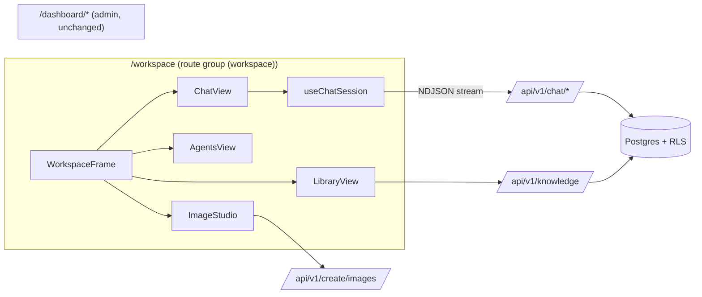

# TuGPT Workspace (`/workspace`)

The Workspace is where people **use** TuGPT: chat, agents, the library and image creation.
The Dashboard (`/dashboard/*`) stays the **administration** surface: organization settings,
integrations, users, usage and governance. The two share one session, one tenant context and
one chat runtime.

## Spec

| Area | What it does | Backed by |
|---|---|---|
| Layout | Own frame: sidebar (brand, new chat, search, sections, recent chats, upcoming areas, Dashboard link, account menu), desktop collapse, mobile drawer with focus trap | `components/workspace/WorkspaceFrame.tsx` |
| Recent chats | Newest 50, grouped Today / Yesterday / Previous 7 days / Older; live updates while streaming. With Agent 4's conversations API: folders, rename, move, archive (with undo) and delete (confirmed), archived view | `ThreadsProvider` → `GET /api/v1/chat/threads`, `/api/v1/chat/folders` |
| Search | Ctrl/⌘+K. Immediate local filter of loaded chats; with the conversations API also a debounced server search over all chats including message text (excerpt shown) | `group-threads.ts`, `listConversations({ q })` |
| Chat | Streaming NDJSON, Markdown, @ apps, approval cards, stop, retry | existing `useChatSession` + `/api/v1/chat/*` (unchanged API) |
| Model selector | Listbox menu, keyboard operable, private/hosted grouping, tool-capable badge | `ModelMenu.tsx`, models from the server config |
| @ selector | Type `@` or press the "Use an app (@)" button | existing mention picker |
| Files | Small text files inline in the message (the model reads them). PDF, Word, Excel, PowerPoint, images and larger text are uploaded (≤ 25 MB) and linked to the chat; the UI says the assistant does not read them yet (C-4b). Unavailable server ⇒ refused with the reason | `attachments.ts`, `uploads.ts`, Files API |
| Agents | Built-in TuGPT Assistant (works today) and a custom-agent builder (instructions, model, starters, knowledge, visibility) against contract C-1; Save is disabled with the reason until the Agents API exists | `AgentsView.tsx`, `lib/workspace/custom-agents.ts` |
| Library | Knowledge collections (create/edit/delete, upload with progress, indexing status, reindex/remove, full-text search), starter prompts, and read-only organization knowledge | Library API, `GET /api/v1/knowledge`, `Collections.tsx`, `LibraryView.tsx` |
| Approvals | History (mine / organization), status filter, redacted argument preview, approve with validity + note, reject, cancel, revoke, each confirmed; nav link with pending count and decision notices (45 s polling while visible) | `ApprovalsView.tsx`, `useApprovalFeed.ts`, Approvals API |
| States | Every backend-backed area has loading, empty, error-with-retry and "not available in this workspace yet" states | `states.tsx`, `lib/workspace/service.ts` |
| Images | Existing ImageStudio inside the Workspace frame | `/api/v1/create/images` |
| Identity | Person's name and email in the account menu (Account settings, Sign out). No organization switcher or admin pages in Workspace nav | server session |

## Acceptance criteria

1. `/workspace`, `/workspace/c/[id]`, `/workspace/agents`, `/workspace/library`, `/workspace/images` render inside the Workspace frame for signed-in users; signed-out visitors are redirected to login by the proxy.
2. Sending a message streams a real model reply through the existing `/api/v1/chat` endpoints; the thread appears in recents.
3. Changing the model in the menu changes `modelKey` on the next new thread / message.
4. `@` (typed or via button) opens the app picker; approvals use the existing approval cards.
5. Workspace nav contains only `/workspace/*` links plus one explicit "Dashboard" link; no admin pages.
6. A user only ever sees their own threads and their organization's knowledge (RLS); verified with two orgs.
7. `/dashboard/*` pages behave as before; `/dashboard/chat` redirects (307) to `/workspace`.
8. Desktop, tablet and mobile layouts work; all controls are keyboard reachable with visible focus; strings exist in Spanish and English.
9. Format, lint, type check, unit tests and build pass.

## Architecture and reuse

- No new runtime, auth or API: the Workspace is a new presentation layer over the existing chat session hook, Markdown renderer, mention picker and approval cards.
- Tenant isolation is unchanged: every read goes through the user's RLS-bound client in the existing handlers. The Workspace adds no server reads besides the session role (for the "Manage in Dashboard" hint, which the API re-checks).
- Missing capabilities are typed adapters with explicit "not available yet" states, never placeholder data. See [api-contracts.md](./api-contracts.md).

## Known limits

- Search covers the 50 most recent chats until C-2.
- Rename/delete of chats waits for C-3.
- Only text files can be attached until C-4.
- Custom agents wait for C-1; shared prompt library waits for C-5.
